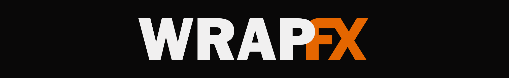

  

<b>360° & 180° VR effects for DaVinci Resolve Studio</b> 
By <a href="https://www.surroundsync.com/"><b>SurroundSync</b></a> in collaboration with <a href="https://whitesparkpictures.com.au/"><b>Whitespark Pictures</b></a>

  

---

WrapFX is a set of tools made specifically with 360° and VR180 video in mind, not forgetting working in both Stereo and Mono.
Designed for DaVinci Resolve Studio, Nuke & VegasPro. Perfect seamless FX.

---
## Installing

**You need:** DaVinci Resolve **Studio** (the paid version: the free version doesn't load OpenFX plugins).

### Windows

1. Download `WrapFX-Windows.zip` and unzip it. You'll get a folder called `WrapFX.ofx.bundle`.
2. Close Resolve.
3. Copy `WrapFX.ofx.bundle` into `C:\Program Files\Common Files\OFX\Plugins\` (create the folders if they don't exist) or your OFX Directory.
4. Start Resolve.

For the fast GPU mode, go to **DaVinci Resolve ▸ Preferences ▸ System ▸ Memory and GPU** and set
_GPU processing mode_ to **CUDA** (NVIDIA cards).

### macOS

1. Download `WrapFX-macOS.zip` and unzip it.
2. Close Resolve.
3. Copy `WrapFX.ofx.bundle` into `/Library/OFX/Plugins/` (create the folders if they don't exist).
4. Start Resolve.

For the fast GPU mode, set _GPU processing mode_ to **Metal** in **DaVinci Resolve ▸ Preferences ▸ System ▸
Memory and GPU**. It needs macOS 13 or later on Apple silicon (M1 and newer) or a recent AMD / Intel Mac.
Older Macs run the tools on the processor, which is slower. The first time each tool renders, macOS takes
a moment to prepare its GPU code.

### Finding the tools

On the Fusion page, right-click in the node area and choose **Add Tool ▸ OpenFX ▸ WrapFX**. Some tools are also availabe in Edit & Colour pages.

---

## The tools

| Tool               | What it does                                                                                     |
| ------------------ | ------------------------------------------------------------------------------------------------ |
| **VRBlur**         | Blur a 360° shot evenly in every direction                                                       |
| **VRSharpen**      | Sharpen a 360° shot evenly in every direction                                                    |
| **VRDenoise**      | Remove noise and grain, using neighbouring frames and the picture itself                         |
| **VRProjection**   | Place titles, logos, screens, panoramas or fisheye footage into the 360°                         |
| **VRLensFlare**    | Lens flares that wrap around the viewer, in mono or stereo                                       |
| **VRBloom**        | Make bright lights glow, or give a soft dreamy "diffusion" look                                  |
| **VRDefocus**      | Blur parts of the shot, or fake depth of field from a depth map                                  |
| **VRNoise**        | Generate fog, clouds, smoke, energy and textures that wrap around the viewer                     |
| **VRGrain**        | Add film grain that looks even all the way round                                                 |
| **VRSky**          | Create skies, colour washes and a sun, or a real sky for any place and time                      |
| **VRChroma**       | Add colour fringing for a lens-like look                                                         |
| **VRFrameAverage** | Average frames together: remove noise, remove passers-by, or make light trails                   |
| **VRStereoAlign**  | Fix stereo footage that's uncomfortable to watch, and check it                                   |
| **VRGuide**        | Show a grid, the horizon and the front of the scene while you edit                               |
| **VRPreview**      | Look around a 360° like in a headset: drag in the viewer, quick-look buttons, a six-view grid, left / right eye or 3D anaglyph |
| **VRReProject**    | Turn 360° into normal flat video (animate where it looks), fisheye, tiny planet or cube maps     |
| **VRVignette**     | Fade the top and bottom to black, a colour or transparency; irises and wipes                     |
| **VRSlate**        | Burn in timecode, frame rate, resolution, date and your own text: flat, or readable in a headset |
| **VRTiler**        | Repeat a tileable texture over a full 360 sphere, with scale, offset, rotation and blends  |
| **VRTurbulentDisplace** | Warp the 360° with fractal noise: flowing water, heat haze, funhouse mirrors, waving flags |
| **VRDisplace**     | Push the picture around with a displacement map, without tearing at the seam or poles |

All of them run on the graphics card for speed: **NVIDIA** cards on Windows (CUDA) and **Apple silicon**
and recent Macs (Metal). Most take a fraction of a second per 8K frame. On other machines they run on
the processor.

---

## Getting started

1. Add a tool and connect your 360° footage to its input, like any other Fusion node.
2. Open the **Image** section at the top of the controls:
   - **Layout:** is your footage **Mono**, **Stereo Over-Under** (one eye above the other) or
     **Stereo Side-by-Side**? Set this first. If it's wrong, the two eyes get mixed together.
   - **Output Size** (tools that create images from nothing): **Project / Timeline** automatically
     matches your timeline resolution. You can also pick 4K–12K or a custom size.
3. Check the result in a headset or in Resolve's 360° viewer, not just the flat picture. Near the top
   and bottom of the flat picture a correct effect can look odd. That's the effect undoing the
   stretching you'd otherwise see in the headset.

### Things that work the same everywhere

- **Sizes are in degrees**, an angle around the viewer, not pixels. So the same settings look the same
  at 4K or 8K and with proxies. As a feel: all the way round is 360°, a phone held at arm's length
  covers about 10°, and in an 8K video 1° is about 23 pixels.
- **Distance** is in metres from the viewer. In stereo, closer things pop out more. Keep text and
  graphics around 2 m or further to stay comfortable.
- **Mix / Opacity:** 0 = the original, 1 = the full effect.
- **Red / Green / Blue / Alpha** tickboxes choose which channels an effect changes.
- **Quality:** Draft while you experiment, Normal for the final render.
- Hover over any control in Resolve for a short explanation.

---

## The tools in detail

### VRBlur

A blur that's the same strength in every direction in the headset, with no line at the back and
no smearing at the top or bottom.

- **Blur Size:** how much to blur, in degrees.
- **Quality:** Draft is fastest; Normal is fine for final renders.

### VRSharpen

Sharpening that's even all the way round. A normal sharpen over-sharpens the top and bottom of a
360° video.

- **Amount:** how strong. 1 = a normal amount; negative values soften.
- **Radius:** the size of detail to sharpen. 0.1° is about 2 pixels in 8K.
- **Threshold:** leaves weak detail alone, so grain doesn't get sharpened.
- **Luminance Only:** on by default; sharpens brightness only, which avoids coloured edges.

### VRDenoise

Cleans up noise and grain. It averages each frame with its neighbours, lining them up first so camera
moves don't smear. It then cleans whatever noise remains within the frame, working harder where the
neighbours couldn't help (fast motion, people walking past).

- **Temporal NR:** how much to use neighbouring frames. **Spatial NR:** how much to clean within the frame.
- **Motion Compensation:** keep on for moving shots; off is faster for tripod shots.
- **Sample Direction / Frames:** which and how many neighbouring frames to use.
- **Noise Level:** _Auto_ measures it for you. **Noise Level Scale** above 1 cleans harder, below 1 more gently.
- **Luma / Chroma:** how much brightness noise and colour noise to remove. Lower _Luma_ keeps more texture.

### VRProjection

Puts a flat image into your 360° shot: titles, logos, screens, photos, video, panoramas, fisheye
footage. Connect the image to **Source** and your 360° shot to **Background**.

- **Projection:**
  - **Flat:** a flat card floating in space. Best for titles and screens up to about 100° wide.
  - **Spherical:** wraps the image around you by _Angle_ with no stretching. Use it for wide images
    and panoramas. A square image at 180° fills the front half exactly, and a 2:1 panorama at 360° fills everything.
  - **Cylindrical:** wraps around you like a curved cinema screen.
  - **Fisheye:** for fisheye footage, such as VR180 lenses.
  - **Camera:** treats the image as a normal camera shot with a given field of view.
- **Yaw / Pitch / Roll:** where to put it (left/right, up/down) and how to tilt it.
- **Distance:** how far away it is. For Flat, further = smaller. In stereo, this sets the depth.
- **Width** (Flat) or **Angle** (Spherical, Cylindrical, Camera): how big it is.
- **Merge:** _Over_ for normal images, _Add_ or _Screen_ for light (glows, fire, flares).
- **Anti-aliasing:** higher = smoother edges on small text.

### VRLensFlare

Lens flares that wrap around the viewer. Nothing gets cut off at the edge of a frame, and in stereo
the flare has real depth.

**Positioning the flare:** select the VRLensFlare node and look at the viewer. A **yellow "Light"
handle** sits on the light: **drag it onto your sun or lamp**. A **blue "Lens" handle** shows where the
imaginary camera lens is pointing; the ghosts line up between the two, so drag it to change the
flare's shape. In stereo there's a handle in each eye, and you can drag either.
If the handles don't show, make sure the viewer's on-screen controls are switched on. You can
also type the position into _Light Yaw / Light Pitch_.

- **Lens Flare Preset:** a starting look: Warm Sun, Golden Hour, Clean Sun, Space Star, Blue
  Anamorphic, Headlight, Sci-Fi, Vintage Lens and more. Change anything afterwards and it shows _Custom_.
- **Composite Type:** _Add_ (usual), _Screen_ (softer), _Normal_, or _Flare Alone_ (just the flare, on black).
- **Light & Lens:** the light's position and, for stereo, its _Distance_ (0 = far away, like the sun).
  _Lens Axis_ is where the imaginary lens points.
- **Light Source Masking:** dims the flare when something covers the light (a person walking in front of
  the sun). _Masking Affects_ chooses whether the ghosts dim too.
- **Global Corrections:** overall brightness, size, stretch (anamorphism), softness and colour.
- **Elements:** each part of the flare has its own section that you can switch on or off:
  - **Glow:** the bright core.
  - **Starburst:** sharp spikes.
  - **Shimmer:** soft fine rays.
  - **Anamorphic Streak:** a long horizontal line.
  - **Halo:** a rainbow ring.
  - **Ghosts:** reflections inside the lens. _Stereo Depth_ sets how far they float in 3D.
  - **Hoop:** a ring around the lens centre.
  - **Full-Screen Glare:** a soft haze.

### VRBloom

Makes bright parts of the image glow, evenly in every direction.

- **Threshold:** how bright something must be to glow (0 = everything glows). **Knee** softens it.
- **Radius / Levels / Falloff:** the size of the glow, and how far its haze spreads.
- **Mode:** _Add_ (classic glow), _Screen_ (softer), _Mix (Diffusion)_ (a dreamy, low-contrast "Pro-Mist" look).
- **Intensity / Tint:** strength and colour of the glow.

### VRDefocus

Blurs parts of the shot by different amounts. Connect a black-and-white image to **Map**.

- **Map Is:** _Blur Amount_ (white = most blurred, black = sharp), or _Depth_ (a depth pass, in metres).
- **Max Blur:** the strongest blur, in degrees.
- **Focus Distance / Aperture** (Depth mode): what's in focus, and how shallow the focus is.

### VRNoise

Creates moving textures that wrap all the way round: fog, clouds, smoke, energy, mattes.

- **Type:** _fBm_ (soft clouds), _Turbulence_ (billowy), _Ridged_ (sharp veins), _Cells_ / _Cell Edges_ (cellular).
- **Size / Detail / Roughness:** the scale of the pattern and how much fine detail it has.
- **Evolution:** animate this to make the pattern change over time. **Rotate** to drift it around the viewer.
- **Low / High Color:** the colours (and transparency) of the dark and bright parts.
- **Merge:** how it combines with your footage (_Screen_ works well for fog).
- **Depth** (stereo): how far away the texture sits.

### VRGrain

Film grain that looks the same all the way round.

- **Amount / Size:** how strong and how coarse.
- **Mid-tone Response:** 1 = grain mostly in the mid-tones, like real film.
- **Colour:** 0 = black-and-white grain, 1 = coloured.
- **Animated:** new grain every frame. **Independent Eyes:** different grain in each eye, like two real cameras.

### VRSky

Skies, colour washes, Sun & Moon

- **Mode:** _Real Sky_ (the default, below), _Sky_ (ground / horizon / sky colours), _Linear_ (one
  direction to the other) or _Radial_ (spreading from a point).
- **Gradient Colors:** _Color A / B / C_, with _Horizon_ and _Falloff_ to shape them.
- **Sun:** a sun disc with a glow, with its own position, size, colour and brightness.

**Real Sky** works out where the sun and moon really are for a place, date and time, then paints a
matching sky: blue at midday, golden near sunset, a warm glow on the horizon at dusk, then night with
the moon and stars. Animate _Time of Day_ for a time-lapse effect.

- **Latitude / Longitude:** where you are, in degrees (north and east are positive). London is
  51.5, −0.13; New York 40.7, −74.0; Sydney −33.9, 151.2. Copy them from any map app.
- **Year**, **Month**, **Day** and **Time of Day:** local clock time in hours (14.5 = 2:30 pm). It
  carries on past midnight: 26 is 2 am the next morning, so you can animate through the night.
- **UTC Offset:** your time zone, including summer time. UK summer is +1, New York winter −5.
- **North Direction:** where north is in your 360° frame, as a yaw. If the camera faced east,
  north is −90. Get this right and the sun lands where it was on the day you shot.
- **Haze:** how much dust and moisture is in the air (scientists call it _turbidity_). 2 is crystal
  clear, 3 a clear day, 6 and up hazy. It also makes sunsets redder.
- **Sky Brightness** and **Twilight Glow:** overall brightness, and the warmth along the horizon
  around sunrise and sunset.
- **Ground Color** and **Night Sky** colours finish it off. The sun's position is set for you in Real
  Sky; the _Sun_ group still sets its size and glow.
- **Stars:** density, brightness and pattern. **Animate Stars** turns them with the real sky as
  _Time of Day_ changes, wheeling around the pole star (or the south celestial pole). Animate
  _Time of Day_ across the night for a star-lapse. Turn it off to keep the stars still.
- **Moon:** the moon in its real place and phase, lit from the sun's side so the crescent points the
  right way. _Moon Size_ 1 is its real size; go bigger for drama. _Brightness_ and _Glow_ to taste.
  _Moon Colour_ tints it (and the moonlight on clouds). Tick _Override Phase_ to set the phase yourself
  with _Phase_ (0 new, 0.25 half, 0.5 full, 0.75 half, 1 new). Turn off _Surface Detail_ for a plain,
  even disc.
- **Clouds** (off by default). _Type_ picks how they're made:
  - **Volumetric (3D):** real 3D clouds with uneven, ragged bases and billowing tops. They shade
    themselves, with bright silver edges toward the sun and pink and orange at sunset.
  - **Flat (2D):** a single painted cloud layer. Much faster; good for thin or distant cloud.

  The moon lights them at night. _Cover_ goes from clear (0) to overcast (1). _Thickness_ goes
  from flat sheets (1) through fair-weather cumulus (4, the default) to towering heaps (12+).
  _Detail_ adds finer, crisper cauliflower edges. _Softness_ goes from crisp to wispy. They drift
  with _Wind Direction_ and _Wind Speed_ and change shape with _Evolve Speed_: turn both up for a
  time-lapse look. _Quality_ trades speed for smoothness. Use Draft while setting up and Normal or
  High for the final render.

### VRChroma

Colour fringing, like a real lens.

- **Mode:** _Radial_ (grows away from a centre point) or _Lateral_ (a fixed sideways shift).
- **Strength** or **Shift:** how much. **Samples** above 1 gives a softer, rainbow-like fringe.

### VRFrameAverage

Combines each frame with its neighbours.

- **Mode:** _Mean_ (remove noise), _Median_ (remove people and things passing through, for a
  clean plate), _Trimmed Mean_ (robust noise removal), _Max / Min_ (light trails).
- **Sample Direction / Frames / Frame Step:** which neighbouring frames to use.
- **Missing Frames:** what to do at the start and end of the clip.
- **Motion Compensation:** lines the frames up first, for shots where the camera moves.

### VRStereoAlign

Fixes and checks stereo (3D) footage.

- **View:** _Output_, _Anaglyph_ (red/cyan, to check alignment, with or without glasses),
  _Difference_ (shows where the eyes differ), or one eye in both halves.
- **Vertical Alignment / Eye Roll:** remove the up/down and twist differences between the eyes
  that cause eye strain.
- **Convergence:** moves the whole scene further away or closer.
- **Yaw / Pitch / Roll (both):** turn both eyes together, to re-centre the scene or level the horizon.

### VRGuide

On-screen guides while you edit. Each guide has its own section that you can switch on or off.

- **Grid:** latitude/longitude lines. **Horizon:** eye level.
- **Direction Markers:** front (green), back (red) and sides (yellow).
- **Action Safe Zone:** darkens areas viewers are unlikely to look at.
- **Pole Caps:** marks straight up and straight down, where rigs and tripods usually are.

### VRPreview

A window into the 360°, like wearing a headset. **Drag anywhere in the viewer** to look around (the
scene follows your pointer). _Field of View_ zooms. _Eye_ shows the left or right eye of stereo
footage, or both as a red-cyan **anaglyph** for 3D glasses. The output is a normal flat picture at the
timeline's size (_Output_). Use it to check your work, or to make quick flat previews.

- **Quick Look:** six buttons (_Left_, _Front_, _Right_, _Back_, _Up_, _Down_) point the view straight
  that way.
- **Six View Grid:** _Show Six Views_ shows every direction at once as labelled fisheye views: LEFT,
  FRONT, RIGHT on top and BACK, UP, DOWN below, fitted inside the frame. _Fisheye Field_ 90° shows
  exactly one face of a cube per view; widen it to overlap them. _Labels_ turns the names off. A
  Quick Look button takes you back to a single view.

### VRReProject

Turns 360° into other kinds of picture.

- **Format:**
  - _Rectilinear_: a normal camera. Keyframe _Look Yaw / Pitch / Roll_ and _Field of View_ to direct
    the viewer's eye and make ordinary 16:9 or vertical video from 360° footage. With _Click & Drag_
    on, you can also drag in the viewer to aim it.
  - _Fisheye_: up to 360° (_Fisheye Field_), as a circle or filling the frame.
  - _Tiny Planet_: the ground becomes a little planet. _Planet Field_ sets its size; _Look Pitch_
    180 flips it into a "rabbit hole" of sky.
  - _Equirectangular (rotated)_: the 360° again, turned (re-centre it or level the horizon).
  - _Cube maps_: six 90° faces as a 6x1 strip, a 3x2 grid, or a horizontal / vertical cross.
    _Equi-Angular Faces_ gives even detail across each face (EAC).
- **Output:** _Output Width_ (the timeline's, or a preset) and _Aspect Ratio_ (Auto, 16:9, 9:16
  vertical, 1:1, 4:5, 2.39:1...). _Eye_ picks the left or right eye of stereo footage, an anaglyph,
  or both (_Stereo_). _Quality_ Best or Ultra smooths wide views and tiny planets.

### VRVignette

Fades and transitions measured on the sphere, so they're seamless and round in the headset.

- **Mode:**
  - _Top & Bottom_: cover the poles (hide a tripod, darken the sky). _Size_ is the solid cap.
  - _Iris_: a circle around a direction; animate _Iris Size_ to open or close.
  - _Linear Wipe_: an edge sweeps across the sphere.
  - _Radial Wipe_: a clock wipe around the horizon, or any axis.

  _Feather_ softens the edge and _Invert_ swaps the sides.

- **Fill:** _Blend_ fills with the _Color_ (Normal, Multiply, Screen, Add, Overlay) or makes it
  _Transparent_. _Opacity_ fades the whole effect in and out.

### VRSlate

Burns information into the picture, like Resolve's Data Burn-In.

- **Burn-In:**
  - _Timecode_: counted from _Start Timecode_. _Drop Frame_ for 29.97 / 59.94, and _Frame Offset_
    to line it up with an edit.
  - _Frame Number_, _Frame Rate_, _Resolution_, _360 Format_ (mono or stereo) and _Date_.
  - Three _Custom Text_ boxes (project, shot, take, notes...). They can be several lines.

  _Labels_ puts "TC" / "Frame" in front. _Arrange_ puts everything on one line or one item per line.

- **Position:**
  - _Flat_ puts it in the frame at a corner, edge or centre (bottom centre by default), readable on a
    monitor.
  - _In View_ puts it on the sphere at _View Yaw / Pitch_, readable in a headset. _Curved_ keeps every
    word the same size; _Flat Card_ is a flat sheet.
  - _Eyes_ burns into both eyes of stereo footage, or one.
- **Style:** _Font_ (Mono keeps the digits steady, or Sans), _Text Size_, colours, the background box
  and its padding, _Opacity_.

### VRTiler

Repeats a tileable texture (connected to **Texture**) over the whole sphere. Connect a background to
**Source** if you want one.

- **Mapping:**
  - _Sphere_ keeps the tiles the same size everywhere, straight up and down included, with no seam. It
    projects the texture from six directions and blends them softly. You may notice those soft joins
    on very regular patterns: _Blend Sharpness_ narrows them, and _Orientation_ moves them.
  - _Equirect_ is a plain grid in the flat frame. Exact on a monitor, but it squeezes toward the
    poles in a headset.
- **Scale (Tiles), Offset X / Y, Rotation:** size, position and angle of the texture. Animate the
  offsets to scroll it.
- **Blend:** Normal, Multiply, Screen, Add, Overlay or Replace, with _Opacity_. _Quality_ Best or
  Ultra stops small tiles shimmering.

### VRTurbulentDisplace

Warps the 360° with fractal noise: flowing water, heat haze, funhouse mirrors, waving flags. The warp
is worked out on the sphere, so there's no seam at the back and no pinching at the poles, and both
stereo eyes warp identically.

- **Displacement:**
  - _Turbulent_ warps every which way. _Bulge_ makes swelling bubbles and _Twist_ makes swirls. The
    _Smoother_ versions are softer and slower.
  - _Vertical_ / _Horizontal_ warp only up-down or only sideways. _Cross_ does both.
- **Amount:** how far the picture is pushed (degrees). **Size:** how big the warps are (degrees across).
  **Complexity:** low is smooth and broad, high adds finer ripples.
- **Turbulence Offset:** _Offset X / Y / Z_ picks which part of the noise is used (animate it to make
  the warp drift). _Yaw / Pitch / Roll_ turn the whole field, and _Random Seed_ gives a new pattern.
- **Evolution:** animate it to make the turbulence change (360 = one revolution). _Cycle Evolution_
  loops it every _Cycle_ revolutions, for seamless loops.

### VRDisplace

Pushes the picture around using the colours of a displacement map connected to **Map**, like a flat
displacement map but measured on the sphere. Pixels pushed off one side come back on the other, and
nothing tears at the poles.

- **Use For Horizontal / Vertical:** which part of the map's colour drives each push: Red, Green,
  Blue, Alpha, Luminance, Hue, Lightness or Saturation. Mid grey (0.5) means no push. _Full_ always
  pushes fully, and _Half_ / _Off_ never push.
- **Max Horizontal / Vertical Displacement:** the biggest push (degrees). High values sample to the
  right and below, so the picture moves left and up. Use negative values to flip the direction.
- **Map Behaviour:** _Stretch to Fit_ covers the whole 360° with the map. _Tile_ repeats it at its own
  pixel size, and _Centre_ places it once in the middle.
- **Map Layout:** _Mono_ uses one map for both eyes, which keeps stereo comfortable. _Same as Source_
  is for a map packed like your stereo footage.

## Troubleshooting

| Problem                                                           | Try this                                                                                                       |
| ----------------------------------------------------------------- | -------------------------------------------------------------------------------------------------------------- |
| The tools aren't in the menu                                      | Check the bundle is in the right folder, and that you're using Resolve **Studio**.                             |
| The two eyes look mixed up or doubled                             | Set **Layout** (Image section) to match your footage.                                                          |
| A generated image is the wrong size                               | Connect your 360° footage to its _Source_, or check _Output Size_.                                             |
| Text in VRProjection is stretched                                 | Use a normal 16:9 Text+ frame. For anything wider than ~100°, use _Projection_ Spherical or Cylindrical.       |
| Stereo text or flares are uncomfortable                           | They're too close. Increase _Distance_ (or a flare's _Stereo Depth_).                                          |
| The flare disappears with masking on                              | Lower _Mask Threshold_, or set _Masking Affects_ to _Light Only_.                                              |
| Can't see the flare handles                                       | Select the VRLensFlare node and switch on the viewer's on-screen controls, or use _Light Yaw / Pitch_.         |
| VRDenoise looks waxy                                              | Lower _Spatial NR_ or _Noise Level Scale_.                                                                     |
| Something looks odd at the very top or bottom of the flat picture | That's usually correct. Check it in the headset or the 360° viewer.                                            |
| "GPU render failed"                                               | Update your NVIDIA driver, or switch Resolve's GPU processing mode to OpenCL to use the slower processor mode. |

## Licence

Free for any use, including commercial. Credit is appreciated but not required:
**"VR effects: WrapFX by SurroundSync"**. See [LICENSE.md](LICENSE.md) for details.

---

VRSlate's text uses the DejaVu fonts (Bitstream Vera licence). See `docs/FONT-LICENSE.txt`.

WrapFX by <a href="https://www.surroundsync.com/"><b>SurroundSync</b></a> in collaboration with <a href="https://whitesparkpictures.com.au/"><b>Whitespark Pictures</b></a>

